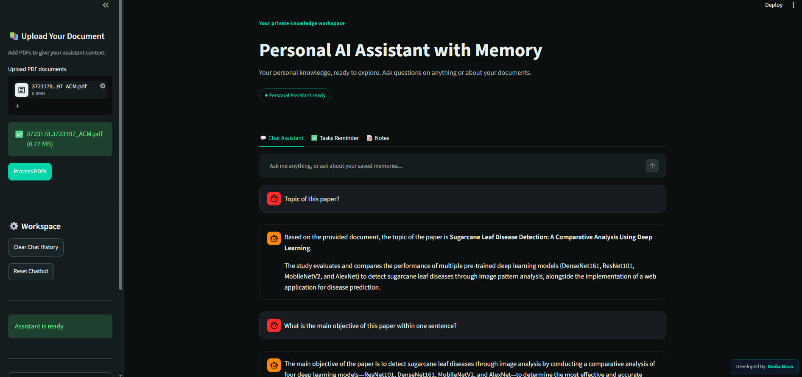
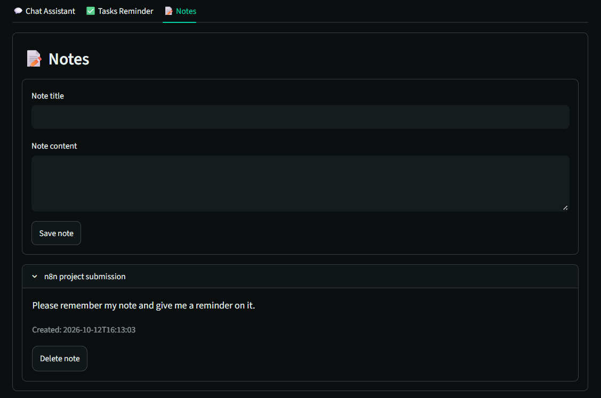
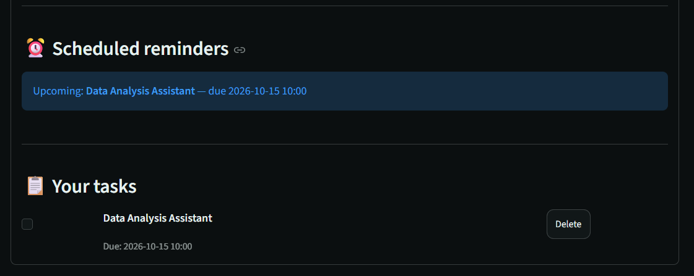

# 🤖 Personal AI Assistant
###  • RAG Document Analyzer • Long-Term Memory • Task Reminders • Personal Notes

An AI-powered personal assistant built with Python that combines document question answering, long-term conversational memory, task reminders, and personal note management — all from one workspace.


<p align="left">
  
  
  
  
</p>

---

## ✨ Overview

**Personal AI Assistant** is a Python-based AI application that combines Retrieval-Augmented Generation (RAG), persistent long-term memory, task management, and personal notes in a single interface.

Instead of working with documents and reminders separately, you can use one assistant to ask questions, retrieve relevant information, save important memories, and organize everyday tasks.

The application supports Google Gemini and Ollama integrations, with provider fallback logic configured in the project.

## 🚀 Features

### 📚 1. RAG Document Analyzer
- Upload PDF documents through the Streamlit interface.
- Ask questions about document contents.
- Retrieve relevant document context to support answers.
- View source documents returned by the retrieval pipeline.

### 🧠 2. Long-Term Memory
- Explicitly save important information for future conversations.
- Retrieve relevant saved memories using semantic search.
- Preserve memory across application sessions using persistent storage.
- Keep saved personal memories separate from PDF evidence.

### 💬 3. AI Chat Assistant
- Ask general questions without uploading a PDF.
- Use saved memories when they are relevant to a question.
- Choose between configured Gemini and Ollama providers.
- Use the project's automatic fallback logic when enabled.

### ✅ 4. Task Management & Reminders
- Create and manage personal tasks.
- Add due dates and times.
- View upcoming and due reminders.
- Mark tasks as completed or delete them.

### 📝 5. Personal Notes
- Save notes with titles and content.
- Review previously saved notes.
- Delete notes when they are no longer needed.

### 🔧 6. Personal AI Workspace
- Simple Streamlit-based interface.
- Separate Chat, Tasks, and Notes sections.
- Local configuration through environment variables.
- Persistent data storage for supported application features.

## 🛠️ Tech Stack

| Technology | Purpose |
|---|---|
| Python | Core application logic |
| Streamlit | User interface |
| LangChain | LLM orchestration and RAG components |
| ChromaDB | Vector storage and semantic retrieval |
| Google Gemini | Cloud-based LLM integration |
| Ollama | Local LLM integration |
| PyPDF | PDF text extraction |
| python-dotenv | Environment configuration |

## 🏗️ Project Structure

```text

personal-ai-assistant/
│
├── app.py                                # Main Streamlit application
├── run_app.py                            # Application Launcher/ Application Entry Point
├── chatbot.py                            # Chatbot and RAG orchestration
├── config.py                             # Application configuration
├── llm_handler.py                        # Gemini and Ollama integration
├── document_processor.py                 # PDF processing and text splitting
├── vector_store.py                       # Vector storage and retrieval
├── long_term_memory.py                   # Persistent memory management
├── task_manager.py                       # Tasks, reminders, and notes
├── utils.py                              # Shared utility functions
├── __init__.py                           # Python package structure
├── example_usage.py                      # modular codebase
│
├── requirements.txt                      # Python dependencies
├── .env.example                          # Example environment configuration
├── .gitignore                            # Files excluded from Git
├── README.md                             # Project documentation
├── CITATION.cff                          # software citation guidelines
├── LICENSE                               # BSD 3-Clause License
│
├── Images/
│   ├── Chat Assistant-memory.png         # Application Screenshots
│   ├── Chat-Assistant.png
│   └── Note-Save.png
│   └── Scheduler-List.png
│   └── Task-Reminder.png
│   └── rag-chatbot-pdf-reader-1.png
│
└── tests/
    ├── test_chatbot_memory.py            # test memory script for chatbot
    ├── test_gemini.py                    # test Gemini script
    ├── test_long_term_memory.py          # test long-term memory script
    └── test_setup.py                     # test setup script for LLM RAG Chatbot

```

## ⚙️ Prerequisites

Before getting started, install:

- Python compatible with the selected package versions.
- Git.
- A Google Gemini API key if using Gemini.
- Ollama installed and running if using a local Ollama model.

## 📦 Installation

### 1. Clone the repository

```bash
git clone https://github.com/NadiaNova/personal-ai-assistant-with-memory.git
cd personal-ai-assistant-with-memory
```

### 2. Create a virtual environment

```bash
python -m venv .venv
```

### 3. Activate the environment

**Windows PowerShell**

```powershell
.\.venv\Scripts\Activate.ps1
```

**Linux / macOS**

```bash
source .venv/bin/activate
```

### 4. Install dependencies

```bash
python -m pip install --upgrade pip
python -m pip install -r requirements.txt
```

### 5. Configure environment variables

Create a local `.env` file by copying `.env.example`.

**Windows PowerShell**

```powershell
Copy-Item .env.example .env
```

Open `.env` and configure the provider and model settings required by your application.

Example configuration:

```dotenv
LLM_PROVIDER=gemini
LLM_TEMPERATURE=0.7

GOOGLE_API_KEY=YOUR_GOOGLE_API_KEY
GEMINI_MODEL=YOUR_SUPPORTED_GEMINI_MODEL_ID

OLLAMA_MODEL=YOUR_INSTALLED_OLLAMA_MODEL
OLLAMA_BASE_URL=http://localhost:11434

EMBEDDING_MODEL=YOUR_CONFIGURED_EMBEDDING_MODEL

ENABLE_LLM_FALLBACK=true
FALLBACK_PROVIDER=ollama
```

Use the actual environment variable names expected by your `config.py`. The values above are examples; model identifiers must be supported by the relevant provider.

### 6. Configure your LLM provider

**Option A — Google Gemini**

- Create an API key through Google's official AI developer platform.
- Add the key to your local `.env` file.
- Select the Gemini provider and a supported model.

**Option B — Ollama**

- Install Ollama and start its local service.
- Download a model supported by your application.
- Configure the model name and local endpoint in `.env`.

For example, I have selected a compatible model:

```bash
ollama pull qwen2.5:3b
```

The configured embedding model must also be available if your application uses Ollama for embeddings. Confirm the model requirements in your embedding implementation.

### 7. Run the application

```bash
streamlit run app.py
```

Open the local URL displayed in your terminal.

If you use a separate launcher, follow the command implemented by that launcher instead.

```bash
python run_app.py --provider gemini --port 8502
```

## 📖 How to Use

1. **Start the assistant:** Launch the Streamlit application.
2. **Ask questions:** Use the Chat Assistant tab for general questions.
3. **Analyze PDFs:** Upload a PDF and process it before asking document-specific questions.
4. **Save a memory:** Use an explicit instruction such as `Remember that my preferred programming language is Python.`
5. **Manage tasks:** Add tasks and optionally set a due date and time.
6. **Save notes:** Create titled notes and review them later.
7. **Test persistence:** Restart the application and check whether saved memories, tasks, and notes remain available.

## 🧪 Testing & Troubleshooting

Check the installed dependencies:

```bash
python -m pip check
```

Run the application's available tests using their actual filenames. For example:

```bash
python -m unittest test_long_term_memory.py
python -m unittest test_chatbot_memory.py
```

Some tests may require API credentials, a running Ollama service, or preconfigured local data.

**Common issues**

- **Missing API key:** Check your local `.env` and configuration.
- **Ollama connection error:** Confirm that Ollama is running and the configured model is installed.
- **PDF retrieval problems:** Check PDF processing, embedding configuration, and vector-store initialization.
- **Missing module error:** Activate the correct virtual environment and reinstall dependencies.
- **Empty memory results:** Confirm that memory persistence and embedding search are configured correctly.

## 🔐 Data & Privacy

This project may store personal information in local databases, vector indexes, uploaded PDFs, and application logs.

- Keep personal data and API credentials out of the public repository.
- Use `.gitignore` to exclude local databases, vector stores, uploaded documents, and environment files.
- Use sample documents when demonstrating the project publicly.
- Review your LLM provider's data-handling policy before sending private information to an external service.

Important: Local storage does not automatically guarantee that all information remains on your device. When a cloud-based LLM provider such as Google Gemini is selected, prompts and relevant document context may be sent to that provider for processing.

## 🗺️ Roadmap

Potential future improvements:

- [ ] Add support for more document formats.
- [ ] Improve memory search and management.
- [ ] Add task editing and recurring reminders.
- [ ] Add automated tests for the main application workflows.
- [ ] Improve deployment and configuration documentation.
- [ ] Add authentication for multi-user deployments.


## 🤝 Application Screenshots

**PDF Document Q&A:**



**Personal Notes:**



**Task Reminder:**



## 📄 License

BSD 3-Clause License

## 📄 Citation and Attribution

If you use, adapt, or build upon this project in academic research, coursework, publications, or other projects, please acknowledge the original work and cite this repository.

Please retain the copyright notice and comply with the BSD 3-Clause License when redistributing the source code.

Author: Afsana Nadia

Repository: https://github.com/NadiaNova/personal-ai-assistant-with-memory

For academic work, please use the citation information provided in CITATION.cff or GitHub's Cite this repository option.

---

<p align="center">
  Built with Python and AI to bring documents, memory, tasks, and notes together.
</p>
